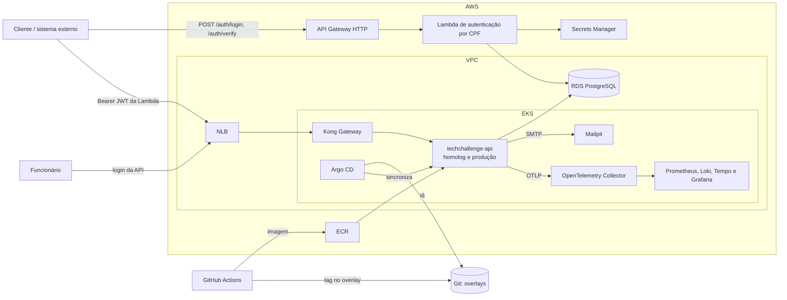
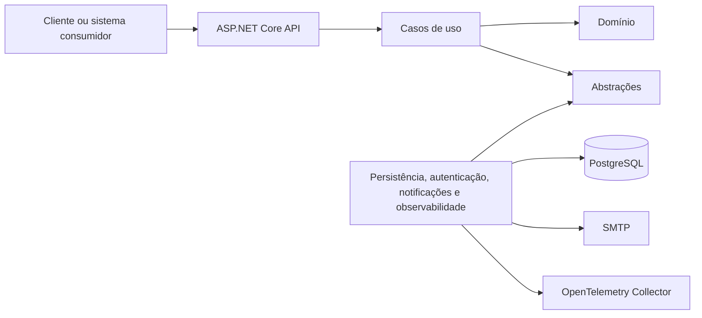

# Tech Challenge - Oficina Mecânica - Fase 3

API desenvolvida para a **Pós-Tech FIAP**. O sistema administra clientes,
veículos, serviços, produtos, estoque e todo o ciclo de vida das Ordens de
Serviço (OS).

Na Fase 3 a solução passa a operar na nuvem: autenticação de clientes por CPF
em uma Function serverless, API Gateway, banco de dados gerenciado, cluster
Kubernetes com escalabilidade, infraestrutura como código, entrega por GitOps e
observabilidade com OpenTelemetry. O projeto foi dividido em quatro
repositórios, cada um com sua pipeline:

| Repositório | Responsabilidade |
| --- | --- |
| [tech-challenge-lambda](https://github.com/tech-challenge-SOAT16/tech-challenge-lambda) | Function serverless (AWS Lambda + API Gateway) que valida o CPF, consulta o cliente e emite o JWT |
| [tech-challenge-k8s](https://github.com/tech-challenge-SOAT16/tech-challenge-k8s) | Terraform da VPC, EKS e ECR; Argo CD, Kong e stack de observabilidade por GitOps |
| [tech-challenge-database](https://github.com/tech-challenge-SOAT16/tech-challenge-database) | Terraform do RDS PostgreSQL, Secrets Manager, bootstrap do banco e Secret da API |
| **tech-challenge-application** (este) | API .NET, testes, imagem Docker, manifests Kustomize e instrumentação |

O histórico das fases anteriores está no repositório legado
[fiap-tech-challenge](https://github.com/louistx/fiap-tech-challenge).

## Entregáveis da Fase 3 neste repositório

| Área | Estado |
| --- | --- |
| Monitoramento (traces, métricas, logs JSON, correlação, dashboards e alertas) | Concluído e validado localmente |
| Métricas de negócio da OS (volume, tempo por status, falhas, integrações) | Concluído |
| Manifests Kubernetes para EKS (probes, HPA, PDB, segurança) | Concluído; overlay de homologação pendente |
| CI: build, testes unitários e de integração | Concluído |
| CD por GitOps (pipeline grava a tag; Argo CD aplica) | Pendente: ajuste do `deploy.yml` |
| Autenticação de clientes com o JWT da Lambda | Concluído e validado com a Lambda local: área do cliente em `/api/v1/cliente` |

Pendências detalhadas e responsáveis: [docs/ToDo.md](docs/ToDo.md).

## Funcionalidades principais

- cadastro de clientes, veículos, funcionários, serviços e produtos;
- categorias de produto, serviço e veículo;
- autenticação de funcionários (JWT, refresh token e autorização por perfil);
- área do cliente autenticado por CPF (JWT da Lambda) com as próprias OS;
- abertura da OS com cliente, veículo, serviços e produtos;
- diagnóstico, orçamento, aprovação, execução, finalização e entrega;
- aprovação ou recusa externa com API key, correlação e idempotência;
- notificação de mudanças de status por e-mail com outbox, retentativa, resumo
  do orçamento e botões assinados para aprovação ou recusa;
- consulta exclusiva de status e acompanhamento público da OS;
- fila operacional priorizada por estado e data;
- entrada, consulta e baixa de estoque sem permitir saldo negativo;
- concorrência otimista nas alterações de estoque;
- cálculo do tempo médio de execução das Ordens de Serviço.

Fluxo principal da OS:

```text
Recebida -> Em diagnóstico -> Aguardando aprovação -> Em execução -> Finalizada -> Entregue
```

## Arquitetura

### Visão de nuvem



### Camadas da aplicação

O projeto utiliza um monólito organizado em camadas, com o domínio isolado dos
detalhes de API, autenticação e persistência.



| Projeto | Responsabilidade |
| --- | --- |
| `TechChallenge.Api` | Endpoints, contratos HTTP, Swagger, saúde e middleware |
| `TechChallenge.Application` | Casos de uso, comandos e validações |
| `TechChallenge.Application.Abstractions` | Interfaces, portas e métricas de negócio |
| `TechChallenge.Domain` | Entidades, estados e regras de negócio |
| `TechChallenge.Infrastructure.*` | PostgreSQL, EF Core, autenticação, SMTP/outbox, OpenTelemetry e injeção de dependências |
| `TechChallenge.Tests` | Testes unitários |
| `TechChallenge.IntegrationTests` | Testes de integração HTTP |

Tecnologias principais: **.NET 10**, ASP.NET Core Minimal APIs, Entity Framework
Core, PostgreSQL, JWT (RS256 para clientes, HS256 para funcionários), OpenTelemetry, FluentValidation,
xUnit, Docker, Kubernetes (EKS), Kustomize, Argo CD, Kong e GitHub Actions.

## APIs

Todas as rotas usam o prefixo `/api/v1`. A especificação completa fica disponível
pelo Swagger quando a aplicação está em execução:

- local: [http://localhost:5020/swagger](http://localhost:5020/swagger);
- Docker: [http://localhost:8080/swagger](http://localhost:8080/swagger);
- Kubernetes (EKS ou kind, via Kong): `http://localhost:8000/swagger`;
- OpenAPI JSON: `/openapi/v1.json`.

Rotas centrais:

| Método | Rota | Finalidade |
| --- | --- | --- |
| `POST` | `/api/v1/ordens-servico` | Abrir OS com cliente, veículo, serviços e produtos |
| `GET` | `/api/v1/ordens-servico/{id}/status` | Consultar o status da OS |
| `GET` | `/api/v1/ordens-servico/oficina` | Consultar a fila operacional priorizada |
| `GET` | `/api/v1/ordens-servico/acompanhamento/{codigo}` | Acompanhamento público da OS |
| `POST` | `/api/v1/integracoes/orcamentos/respostas` | Receber aprovação ou recusa externa idempotente |
| `POST` | `/api/v1/estoque` | Adicionar quantidade ao estoque |
| `GET` | `/api/v1/estoque/{produtoId}` | Consultar saldo por produto |
| `PUT` | `/api/v1/estoque` | Efetuar baixa no estoque |

Os CRUDs de clientes, veículos, funcionários, serviços, produtos, categorias e
usuários estão documentados no Swagger. Por padrão, as rotas exigem autenticação;
login, refresh, OpenAPI, saúde e acompanhamento público são exceções explícitas.
O webhook externo não usa o JWT interno: ele exige o cabeçalho
`X-Integration-Key`. A coleção de requisições fica em
[docs/demo](docs/demo/fase-3/monitoramento.http) (arquivos `.http`, importáveis no Postman).

## Execução local

### Pré-requisitos

- .NET SDK 10;
- PostgreSQL;
- Git;
- Docker Desktop para execução conteinerizada e Kubernetes local.

Clone e acesse o projeto:

```bash
git clone https://github.com/tech-challenge-SOAT16/tech-challenge-application.git
cd tech-challenge-application
```

Configure conexão, JWT e senha do usuário inicial por User Secrets ou variáveis
de ambiente. Exemplo para o terminal local:

```bash
export ConnectionStrings__DefaultConnection="Host=localhost;Port=5432;Database=TechChallenge;Username=postgres;Password=SUA_SENHA"
export Jwt__EnableLocalIssuance="true"
export Jwt__LocalSigningKey="chave-local-somente-dev-com-32-caracteres"
export ApprovalLinks__SigningKey="chave-independente-com-32-caracteres"
export Seed__AdminPassword="SenhaAdmin123"
```

Depois, restaure, compile e execute:

```bash
dotnet restore TechChallenge.slnx
dotnet build TechChallenge.slnx --no-restore
dotnet run --project src/TechChallenge.Api/TechChallenge.Api.csproj
```

A API será exposta em `http://localhost:5020`. As migrations são aplicadas na
inicialização, exceto no ambiente `Testing`.

## Docker

Suba a API, o PostgreSQL, o Mailpit e a stack de monitoramento:

```bash
docker compose \
  -f docker-compose/docker-compose.yml \
  -f docker-compose/docker-compose.override.yml \
  up --build
```

A API ficará em `http://localhost:8080`, o Mailpit em
`http://localhost:8025`, o Grafana em `http://localhost:3000` e o PostgreSQL em
`localhost:5432`. Para incluir a Lambda de autenticação por CPF e a área do
cliente, adicione `-f docker-compose/docker-compose.lambda.yml`; o passo a passo
completo está em [docs/demo/fase-3](docs/demo/fase-3/README.md). A coleção de
requisições pronta para apresentação está em
[docs/demo/fase-2](docs/demo/fase-2/README.md).

Para encerrar:

```bash
docker compose \
  -f docker-compose/docker-compose.yml \
  -f docker-compose/docker-compose.override.yml \
  down
```

O Dockerfile usa múltiplos estágios e usuário não-root. A pipeline publica a
imagem `linux/amd64` no Amazon ECR com a tag formada pelos 12 primeiros
caracteres do SHA. No Docker Desktop em Apple Silicon, essa imagem é executada
por emulação.

## Monitoramento

A API exporta traces, métricas e logs via OpenTelemetry. O compose inclui o
`grafana/otel-lgtm` (Collector, Prometheus, Loki, Tempo e Grafana) com os
dashboards e alertas já provisionados. Grafana em `http://localhost:3000`,
sem login. Detalhes em [docs/monitoramento.md](docs/monitoramento.md);
requisições para gerar dados em
[docs/demo/fase-3/monitoramento.http](docs/demo/fase-3/monitoramento.http).

## Testes

```bash
dotnet test tests/TechChallenge.Tests/TechChallenge.Tests.csproj
dotnet test tests/TechChallenge.IntegrationTests/TechChallenge.IntegrationTests.csproj
```

Última validação registrada:

- 126 testes unitários aprovados;
- 36 testes de integração aprovados;
- build Release sem erros ou avisos.

Estratégia, cenários e limitações: [docs/testes.md](docs/testes.md).

## Kubernetes

Este repositório mantém só os manifests da API: `k8s/base` (Deployment,
Service, ServiceAccount, ConfigMap e PDB) e o overlay `k8s/overlays/aws-eks`
(imagem do ECR, configuração de produção e HPA de 2 a 10 réplicas por CPU e
memória). Cluster, namespaces, Kong, observabilidade e o Argo CD ficam no
[tech-challenge-k8s](https://github.com/tech-challenge-SOAT16/tech-challenge-k8s);
banco e o Secret `techchallenge-api-secrets` ficam no
[tech-challenge-database](https://github.com/tech-challenge-SOAT16/tech-challenge-database).

O Argo CD lê os overlays da branch `main` deste repositório e aplica a API em
`techchallenge` (produção) e, quando o overlay `k8s/overlays/aws-eks-homolog`
existir, em `techchallenge-homolog` (homologação). Sem AWS, o
mesmo fluxo roda num cluster kind pelo `terraform/local` do repositório de
infraestrutura. Detalhes dos manifests em [k8s/README.md](k8s/README.md).

## CI/CD

| Workflow | Responsabilidade |
| --- | --- |
| `build.yml` | Restore e build |
| `unit-tests.yml` | Testes unitários em push e PR para `main` |
| `integration-tests.yml` | Testes de integração em push e PR para `main` |
| `deploy.yml` | Build, testes, publicação da imagem no ECR e deploy no EKS |
| `discord-notifications.yml` | Aviso de PR e push no Discord (ignorado sem o webhook) |

Fluxo alvo da Fase 3 (GitOps): o `deploy.yml` publica a imagem no ECR e grava a
nova tag no overlay do ambiente, com commit direto na `main` feito pelo
`github-actions[bot]`. O Argo CD detecta a mudança e faz o rollout. Hoje o
`deploy.yml` ainda aplica os manifests com `kubectl`; a troca está registrada em
[docs/ToDo.md](docs/ToDo.md).

## Segurança

- clientes: JWT RS256 da Function Serverless, validado por OIDC discovery/JWKS
  e aceito só na área do cliente (`/api/v1/cliente`), que filtra pelo próprio
  cliente;
- funcionários: login da API com JWT HS256 (chave no Secret); todas as rotas
  da oficina exigem perfil, inclusive as de leitura;
- perfis `Administrador`, `Vendedor` e `Mecanico`; autenticação obrigatória por
  padrão;
- webhook externo protegido por `X-Integration-Key` e idempotente;
- hash de senha com PBKDF2;
- container não-root, filesystem somente leitura e capabilities removidas;
- segredos gerados pelo Terraform, fora do Git;
- `x-correlation-id` em todas as respostas e erros padronizados sem detalhes
  internos;
- relatório de vulnerabilidades em [docs/relatorio-vulnerabilidades.md](docs/relatorio-vulnerabilidades.md).

## Documentação

| Documento | Conteúdo |
| --- | --- |
| [Pendências da Fase 3](docs/ToDo.md) | O que falta, por repositório |
| [Monitoramento](docs/monitoramento.md) | Stack, dashboards, métricas, correlação e alertas |
| [Demo da Fase 3](docs/demo/fase-3/README.md) | Credenciais, subida do ambiente e roteiro do vídeo |
| [Autenticação da Fase 3](docs/autenticacao-fase-3.md) | Clientes (JWT da Lambda) e funcionários, com diagrama de sequência |
| [DDD](docs/ddd.md) e [Event Storming](docs/event-storming.md) | Domínio, eventos e fluxos do negócio |
| [Auditoria do Estoque](docs/auditoria-estoque.md) | Contratos, regras, persistência e testes |
| [Índice completo](docs/README.md) | Inclui os documentos da Fase 2 |

## Equipe

| Participante | RM | GitHub |
| --- | --- | --- |
| Gabriel Teixeira | RM374752 | [@louistx](https://github.com/louistx) |
| Brunno de Oliveira | RM374818 | [@DevDoubleN](https://github.com/DevDoubleN) |
| Luís Henrique | RM374786 | [@Ace0777](https://github.com/Ace0777) |
| Caio Montilha | RM375494 | [@cmontilha](https://github.com/cmontilha) |
| Gustavo Keiji | RM374965 | [@GuKeiji](https://github.com/GuKeiji) |

Organização: [github.com/tech-challenge-SOAT16](https://github.com/tech-challenge-SOAT16)

Projeto acadêmico desenvolvido para o **Tech Challenge da Pós-Tech FIAP**.
