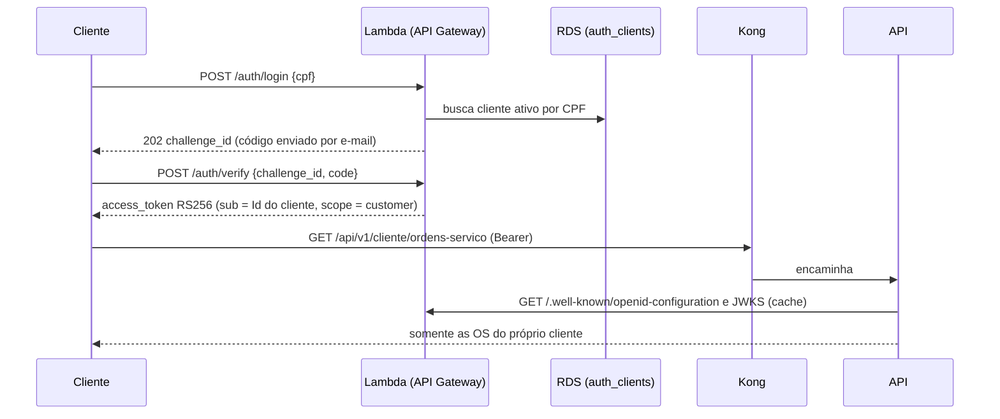

# Autenticação — Fase 3

A API aceita dois tipos de token, cada um em um esquema separado. Um token
nunca vale nas rotas do outro tipo.

| Quem | Como obtém o token | Esquema na API | Onde vale |
| --- | --- | --- | --- |
| Cliente | Login por CPF na Function Serverless ([tech-challenge-lambda](https://github.com/tech-challenge-SOAT16/tech-challenge-lambda)) | `Customer` (RS256, chave pública via JWKS) | Somente `/api/v1/cliente/**` |
| Funcionário | `POST /api/v1/auth/login` da própria API | `Bearer` (HS256, chave no Secret) | Rotas de funcionário, conforme o perfil |



## Cliente (token da Function)

A Function valida o CPF, consulta a view `auth_clients` (criada pelo
[tech-challenge-database](https://github.com/tech-challenge-SOAT16/tech-challenge-database)
sobre a tabela `Cliente`) e emite o JWT. Claims usadas pela API:

| Claim | Valor |
| --- | --- |
| `iss` | URL do API Gateway da Function (output `issuer` do Terraform da Lambda) |
| `aud` | `tech-challenge-api` |
| `sub` | `Cliente.Id` |
| `scope` | `customer` |
| `exp`, `iat`, `nbf`, `jti` | padrão, 15 minutos de validade |

A política `Cliente` exige o esquema `Customer` e `scope=customer`. O `sub`
filtra os dados: o cliente só lista e consulta as próprias OS, e uma OS de outro
cliente responde 404.

| Método | Rota | Resultado |
| --- | --- | --- |
| `GET` | `/api/v1/cliente/ordens-servico` | OS do cliente autenticado |
| `GET` | `/api/v1/cliente/ordens-servico/{id}` | Detalhe da OS, se pertencer ao cliente |

Configuração (sem segredos, no ConfigMap):

```text
CustomerAuth__Enabled=true
CustomerAuth__Authority=<issuer da Lambda>
CustomerAuth__Issuer=<issuer da Lambda>
CustomerAuth__Audience=tech-challenge-api
CustomerAuth__RequireHttpsMetadata=true
```

A API aceita somente RS256 nesse esquema e busca a chave pública pelo
discovery/JWKS, renovando o cache quando recebe um `kid` desconhecido. Sem
`CustomerAuth__Enabled=true`, as rotas da área do cliente não são registradas.

## Funcionário (login da API)

Funcionários (`Administrador`, `Vendedor`, `Mecanico`) usam o login, refresh,
logout e troca de senha da própria API, também em produção. O token é HS256
com a chave `Jwt__LocalSigningKey`, que vem do Secret `techchallenge-api-secrets`
(gerado pelo `tech-challenge-database`) e nunca fica no Git.

```text
Jwt__EnableLocalIssuance=true
Jwt__Issuer=techchallenge-api
Jwt__Audience=techchallenge-funcionarios
Jwt__LocalSigningKey=<Secret, pelo menos 32 caracteres>
```

Todas as rotas sem política própria exigem um funcionário autenticado **com
perfil**, inclusive as de leitura (`GET /clientes`, `/veiculos`, `/produtos`
etc.). Um token de cliente nessas rotas recebe 401.

O esquema de funcionários ainda aceita um emissor externo RS256
(`Jwt__EnableLocalIssuance=false` com `Jwt__Authority`), para o caso de o login
de funcionários migrar para a Function no futuro.

## Assinatura dos links de orçamento

Os links de aprovação e recusa enviados por e-mail não são JWT bearer. Eles usam
HMAC com a chave independente `ApprovalLinks__SigningKey`, também no Secret.

## Decisão

A Function emite apenas tokens de cliente (`scope=customer`, sem perfil). Para
que funcionários continuem operando a oficina na nuvem, o login deles permanece
na API, e os dois tipos de token ficam em esquemas separados. Assim, um cliente
autenticado por CPF não alcança dados de outros clientes nem as rotas da
oficina.
