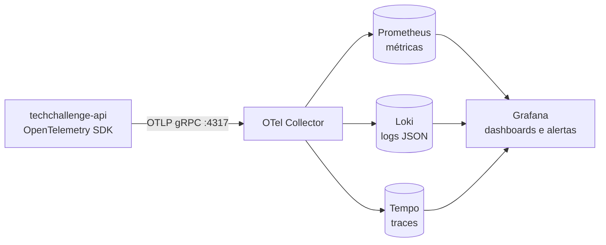

# Monitoramento e observabilidade

A API é instrumentada com OpenTelemetry e envia **traces, métricas e logs** por
OTLP. Localmente, o container `grafana/otel-lgtm` reúne OpenTelemetry Collector,
Prometheus, Loki, Tempo e Grafana, com dashboards e alertas já provisionados.



## Subir localmente

```bash
docker compose \
  -f docker-compose/docker-compose.yml \
  -f docker-compose/docker-compose.override.yml \
  up -d --build db mailpit otel-lgtm techchallenge.api
```

| Serviço | Endereço |
| --- | --- |
| Grafana | `http://localhost:3000` (usuário `admin`, senha `admin`) |
| API | `http://localhost:8080` |
| OTLP | `localhost:4317` (gRPC) e `localhost:4318` (HTTP) |

Para gerar dados, execute [docs/demo/fase-3/monitoramento.http](demo/fase-3/monitoramento.http)
ou o fluxo completo de [docs/demo/fase-2](demo/fase-2/README.md).

No AWS EKS a mesma stack roda no cluster (Argo CD, Kong, Prometheus, Loki,
Tempo e Grafana); o passo a passo está em
[docs/demo/fase-3/README.md](demo/fase-3/README.md).

Sem `OTEL_EXPORTER_OTLP_ENDPOINT`, a exportação OTLP fica desligada e a API
apenas escreve logs JSON no console (testes e CI não mudam).

## Dashboards (pasta TechChallenge)

| Dashboard | Conteúdo |
| --- | --- |
| **TechChallenge - Ordens de Serviço** (home) | Volume diário de OS, tempo médio por status (Diagnóstico, Execução, Finalização), transições, falhas em OS, erros nas integrações (e-mail e webhook de orçamento), decisões externas, latência p50/p95/p99, status HTTP, uptime, health checks, taxa de 5xx, CPU/memória, logs de erro e traces com erro |
| **ASP.NET Core** ([19924](https://grafana.com/grafana/dashboards/19924-asp-net-core/)) | Visão geral HTTP/Kestrel da API |
| **ASP.NET Core Endpoint** ([19925](https://grafana.com/grafana/dashboards/19925-asp-net-core-endpoint/)) | Detalhe por rota e método |

Os JSON ficam em `docker-compose/monitoring/dashboards/` e são carregados pelo
provider `docker-compose/monitoring/dashboards.yaml`.

## Métricas de negócio

Meter `TechChallenge.OrdensServico` (`TechChallengeMetrics`):

| Métrica (Prometheus) | Tipo | Labels | Origem |
| --- | --- | --- | --- |
| `techchallenge_os_criadas_total` | contador | — | abertura de OS |
| `techchallenge_os_transicoes_total` | contador | `status_anterior`, `status_atual` | mudança de status persistida |
| `techchallenge_os_tempo_status_seconds` | histograma | `status` | tempo no status que terminou (desde a transição anterior registrada na outbox) |
| `techchallenge_notificacoes_enviadas_total` | contador | `status` | e-mail entregue pela outbox |
| `techchallenge_notificacoes_falhas_total` | contador | `status` | cada tentativa de envio que falhou |
| `techchallenge_notificacoes_com_falha_total` | contador | `status` | notificação que falhou pela primeira vez (conta uma vez) |
| `techchallenge_notificacoes_recuperadas_total` | contador | `status` | notificação entregue após falhas |
| `techchallenge_integracoes_decisoes_total` | contador | `decisao`, `resultado` | webhook de decisão de orçamento |
| `techchallenge_processamento_falhas_total` | contador | `area`, `tipo`, `status_code` | exceções tratadas pela API |

Notificações pendentes = `com_falha` − `recuperadas` (a outbox reenvia sem limite, com espera crescente até 5 minutos).

Também são exportadas as métricas padrão de ASP.NET Core, Kestrel, HttpClient,
runtime .NET, processo e Npgsql.

## Logs e correlação

- Logs estruturados em JSON no console e enviados ao Loki.
- Cada requisição recebe `x-correlation-id` (o valor enviado é reaproveitado
  quando válido, mesmo contrato da Lambda de autenticação). O header volta na
  resposta e aparece nos logs (`CorrelationId`), no span (`correlation.id`) e
  no corpo dos erros (`correlationId`).
- Os logs no Loki trazem `trace_id`; o campo abre o trace correspondente no Tempo.

Exemplos no Grafana Explore:

```text
Loki:  {service_name="techchallenge-api"} | CorrelationId="demo-123"
Tempo: { span.correlation.id = "demo-123" }
```

## Alertas (Grafana Alerting, pasta TechChallenge)

| Regra | Condição |
| --- | --- |
| Falhas no processamento de ordens de serviço (5xx) | erros internos em `/api/v1/ordens-servico` nos últimos 5 min > 0 (4xx de regra de negócio aparecem só no painel) |
| Falhas no envio de notificações | falhas de e-mail da outbox nos últimos 5 min > 0 |
| Taxa de erro 5xx da API acima de 5% | 5xx / total nos últimos 5 min |
| Latência p95 da API acima de 1s | p95 HTTP (sem health checks) |

As regras ficam em `docker-compose/monitoring/alerting/techchallenge.yaml`.
